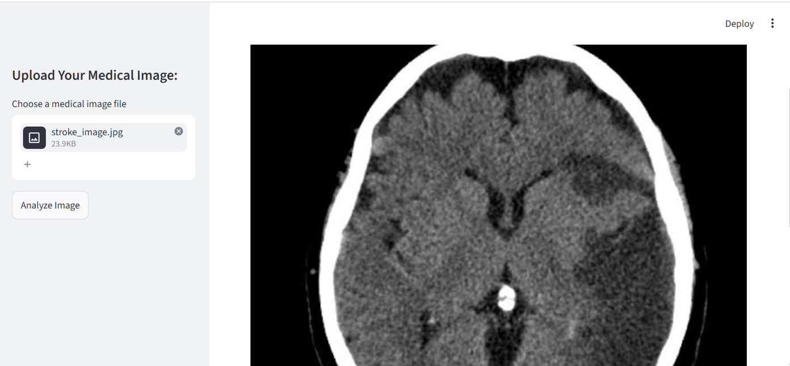
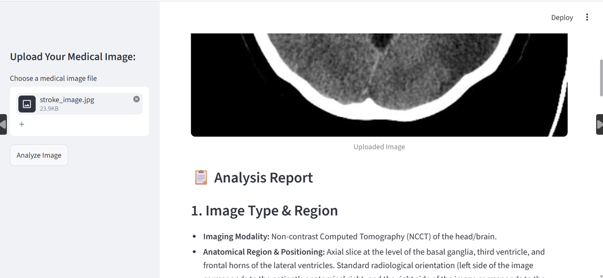
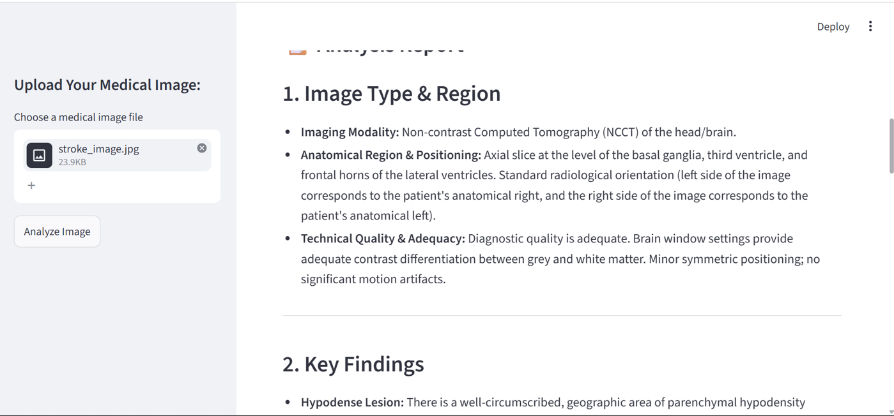
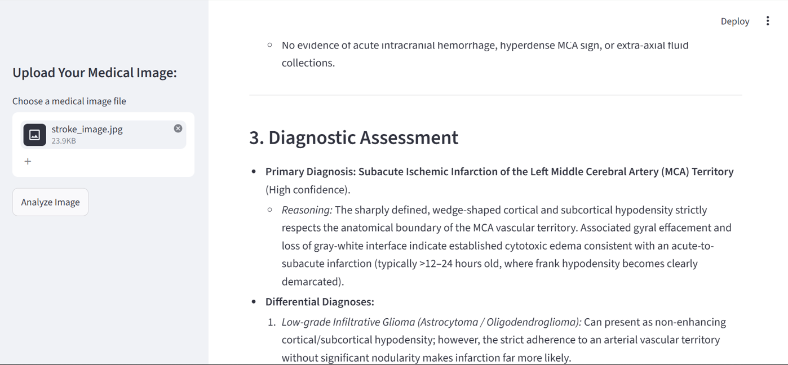
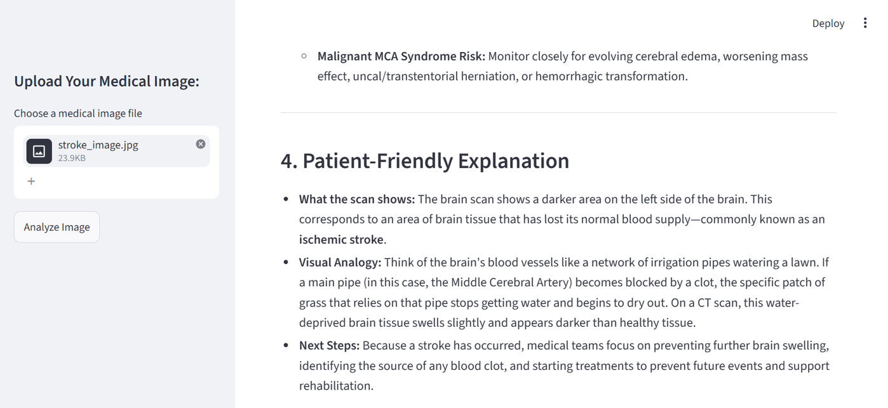

# 🩺 Gen AI Medical Image Analysis Agent

A Streamlit web app that uses a generative AI agent to analyze medical images
(X-ray, MRI, CT, Ultrasound) and produce a structured report with findings,
a diagnostic assessment, a patient-friendly explanation, and supporting
research references.

> ⚠️ **Educational project only. Not a medical device.** See the disclaimer below.

## Demo







## Features

- Upload a medical image (JPG, JPEG, PNG, BMP, GIF) through a web interface
- Automatic image resizing before analysis
- Structured AI report with five sections:
  1. Image type and region
  2. Key findings
  3. Diagnostic assessment (primary and differential diagnoses)
  4. Patient-friendly explanation
  5. Research context with references
- The agent can search the web (DuckDuckGo) for recent medical literature
  and standard treatment protocols
- Temporary files are deleted after each analysis

## How It Works

1. The user uploads an image in the Streamlit sidebar.
2. The image is resized to 500 px width (aspect ratio preserved) and saved
   temporarily.
3. An [Agno](https://github.com/agno-agi/agno) agent sends the image and a
   structured radiology prompt to Google's Gemini model.
4. The agent can call the DuckDuckGo search tool to find supporting medical
   literature.
5. The markdown report is displayed in the app.

## Tech Stack

- Python 3.10+
- [Streamlit](https://streamlit.io/): web interface
- [Agno](https://github.com/agno-agi/agno): agent framework
- Google Gemini: vision and language model
- DuckDuckGo Search: research tool for the agent
- Pillow: image processing


### Set your Google API key

Get a free key from [Google AI Studio](https://aistudio.google.com/).

Command Prompt:
```bash
set GOOGLE_API_KEY=your_key_here
```

PowerShell:
```powershell
$env:GOOGLE_API_KEY="your_key_here"
```

**Never hardcode or commit your API key.**

## Usage

```bash
streamlit run medical_agent.py
```

Then open the local URL shown in the terminal (usually http://localhost:8501),
upload an image in the sidebar, and click **Analyze Image**.


## Project Structure

```
├── medical_agent.py          # main app (the only file you run)
├── requirements.txt    # dependencies
├── assets/
│   └── demo.png        # screenshot for this README
└── README.md
```

## Limitations

- Not trained, tested, or validated on clinical data
- AI output can be inaccurate, incomplete, or misleading
- Image is downscaled to 500 px wide, which may remove fine detail
- Web search results are not verified for quality

## ⚠️ Disclaimer

This project is for **educational and demonstration purposes only**. It is
**not** a medical device and must **not** be used for diagnosis, treatment,
or any clinical decision. Always consult a qualified healthcare professional.
